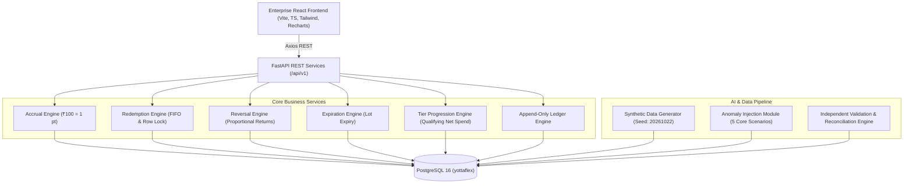

# Architecture Specification: YottaFlex.ai Loyalty & Ledger

## System Architecture

## Key Invariants
1. **Append-Only Immutable Ledger**: Transactions once committed are never altered or deleted. Compensating entries rectify adjustments.
2. **Strict FIFO Point Lot Consumption**: The oldest active point lot is always consumed first.
3. **Qualifying Net Spend Tier Assignment**: Excludes cancellations, taxes, excluded categories and subtracts proportional refunds.
4. **Concurrency Safety**: Employs database row-level locking (`FOR UPDATE`) for zero double-spending.

